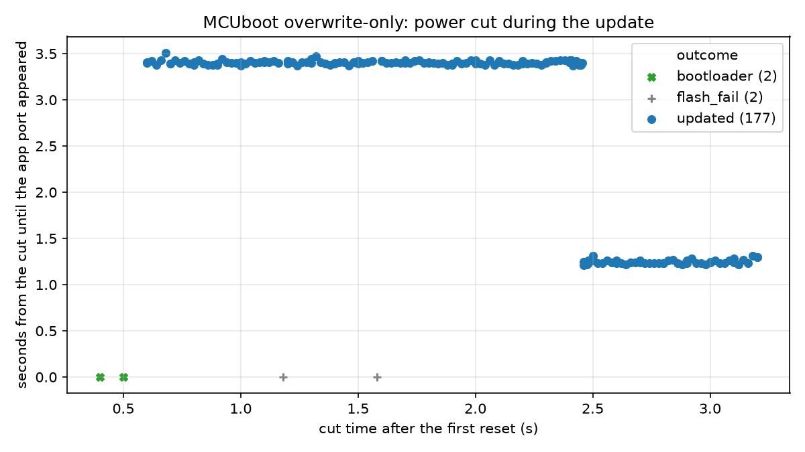

# mcuboot-lab: MCUboot on an Arduino Nano 33 BLE

MCUboot running as a second-stage bootloader on an Arduino Nano 33 BLE (nRF52840) under Zephyr 4.4.2, kept behind the board's own Arduino bootloader so that USB flashing and double-tap recovery still work. Built to compare MCUboot with my own bootloader ([stm32l0-freertos-sensor-node](https://github.com/baliyu/stm32l0-freertos-sensor-node)).

Built with AI assistance (Claude). I ran the builds and the hardware, wrote down what each test showed, and checked the results. Everything marked "inferred" below is my reading of the evidence, not something the board reported. Each hardware run was predicted with a percentage before it was made and scored afterwards, misses included: see [docs/SCORECARD.md](docs/SCORECARD.md). The scripts and their tests were also written with Claude.

## Flash layout

The Arduino bootloader at address 0 is never written. MCUboot sits after it, at the start of the area the Arduino bootloader jumps to.

| Address | Size | Contents |
|---|---|---|
| `0x00000` | 64 KB | Arduino bootloader (untouched) |
| `0x10000` | 64 KB | MCUboot |
| `0x20000` | 128 KB | slot 0, the running app |
| `0x40000` | 128 KB | slot 1, where an update is placed |
| `0x60000` to `0xf7fff` | 608 KB | unused |
| `0xf8000` | 32 KB | storage (unchanged board default) |

The layout is set by `boards/arduino_nano_33_ble.overlay` for the app and `sysbuild/mcuboot.overlay` for MCUboot. Both carry the same partitions.

## Configuration

- `sysbuild.conf`: MCUboot as the bootloader, ECDSA P-256 signatures, the path to my own private signing key, and `SB_CONFIG_MCUBOOT_MODE_OVERWRITE_ONLY=y`. The update mode has to be set here. Setting `CONFIG_BOOT_UPGRADE_ONLY` in `sysbuild/mcuboot.conf` alone was overridden: sysbuild had chosen swap-using-offset.
- `sysbuild/mcuboot.conf`: downgrade prevention and `CONFIG_BOOT_VALIDATE_SLOT0=y` (check the app in slot 0 on every boot).
- `VERSION`: the image version. `CONFIG_MCUBOOT_IMAGE_VERSION` does not exist in Zephyr 4.4.2.
- `prj.conf` and the overlay: console over USB (CDC ACM), so the app can print without extra hardware.

## Build

The signing key is not in this repository. Make your own and put its path in `sysbuild.conf`:

```
python3 ~/zephyrproject/bootloader/mcuboot/scripts/imgtool.py keygen -k lab-signing-key.pem -t ecdsa-p256
export ZEPHYR_BASE=$HOME/zephyrproject/zephyr
west build -b arduino_nano_33_ble --sysbuild .
```

## Flash

The Arduino bootloader's flasher writes at `0x10000` by itself, so I flash without an offset. MCUboot, the app in slot 0 and, for an update test, the update in slot 1 are merged into one file that starts at `0x10000`. The merge refuses to write the file unless MCUboot starts at `0x10000` and ends below `0x20000`, and the app starts at `0x20000` and ends below `0x40000`.

An update is prepared with `imgtool sign --pad --slot-size 0x20000`, which also writes the "update waiting" marker at the end of the slot. The result is placed at `0x40000`.

Then, with the board in bootloader mode (double-tap RESET until the orange LED fades), from PowerShell:

```
& $B --port=COM7 -U -i -e -w -v 'C:\zephyr_flash\lab_image.bin' -R
```

`$B` is the path to Arduino's `bossac.exe` (1.9.1-arduino2). A successful write ends with `Verify successful`.

## Tests

The board has no console during MCUboot, so a refusal is seen only as "the app never started and its USB port never appeared". Two builds were tested, and each row names its build.

**Build A: swap-using-offset (sysbuild's default), 432 KB slots**

| Test | Slot-0 check | Result |
|---|---|---|
| One bit flipped in the app, at `0x20400` | off | the app ran |
| The same bit flipped | on | no app, no USB port (inferred: refused) |
| Good image | on | runs, printing once a second |
| Intact image signed with a different key | on | no app, no USB port (inferred: refused by the signature check) |
| Update from slot 1 | on | ignored (inferred: this mode wants the update at the second sector of slot 1; I did not test that) |

**Build B: overwrite-only, 128 KB slots**

| Test | Slot-0 check | Result |
|---|---|---|
| Good image | on | runs v1.0.0 |
| v1.0.1 signed and placed in slot 1, v1.0.0 in slot 0 | on | the board printed v1.0.1, so the update installed |
| v0.9.0 signed and placed in slot 1, v1.0.1 in slot 0 | on | the board kept printing v1.0.1 (inferred: downgrade refused) |
| One bit flipped in the app, at `0x20400` | on | no app (inferred: refused) |


In Build A the good image was reflashed after each failure and ran every time, so the board itself was not the cause. In Build B the good image ran before the corrupted image was flashed.

## What I measured

| Item | Result |
|---|---|
| MCUboot size, first build (swap-using-offset) | 29,604 B of its 64 KB region (45.17%). Measured again on the overwrite-only build (next rows). |
| MCUboot RAM, first build | 16,128 B (6.15%) |
| MCUboot size, overwrite-only build | 26,076 B of its 64 KB region (39.79%) |
| MCUboot RAM, overwrite-only build | 14,912 B (5.69%) |
| Signed test app | image payload 45,104 B (`0xb030`), 512-byte header, 150-byte signature block |
| Image written for a test | 111,302 B for MCUboot plus one app; 327,680 B when slot 1 is included |
| Default signing key | the public development key from the MCUboot repository. Replaced with my own key. |

## Power-cut test of the update

An Adafruit Feather M0 pulls the RESET pin of the Nano low at a chosen moment while MCUboot is installing an update. After the cut, a PowerShell script waits for the Nano USB port and reads the version the app prints.

**This is a reset, not a power cut.** A reset does not model a falling supply or a slowly discharging capacitor. It is a proxy.

Wiring is two wires: Feather `A1` to the Nano `RST`, and a shared ground. The Feather only pulls the pin low or lets it float and never drives it high (a test checks that the sketch never contains `HIGH`).

Setup: v1.0.0 in slot 0 and a signed v1.0.1 in slot 1, written as one 327,680 B file (SHA-256 `89d7913661abccabcf83a1765e0c2e9f12fe2de7698dd70ba131cd93964e0c2f`). Time zero is the first reset request. Timeline measured with `scripts/portwatch.py`:

| Time after the first reset | What the Nano does |
|---|---|
| 0.35 to 0.60 s | the Arduino bootloader is running (USB ID `2341:005A`) |
| from about 0.6 s | MCUboot runs and installs the update (inferred from the port timings) |
| about 2.455 s | the copy is finished |
| 1.31 s | the app USB port is up, when no update is waiting |
| 3.41 s | the app USB port is up, when an update is waiting and nothing interrupts it |

Three sweeps were run: 100 ms steps from 0.4 to 3.2 s, 5 ms steps from 2.400 to 2.500 s, and 20 ms steps from 0.6 to 3.2 s. Together they give 181 trials: 177 updated, 2 flash_fail, 2 bootloader. Three earlier pilot trials are in `results/pilot_3.csv` and are not in the figure. The 181 are trials, not 181 different cut times, because the grids overlap.

- **updated (177):** every trial from 0.6 s to 3.2 s that reached the cut ended with v1.0.1 running from slot 0. After cuts up to 2.44 s the app port came up about 3.4 s later, the same as an uninterrupted update, so the install was started again (inferred from the timing; I did not read the flash after a cut). After cuts from 2.46 s the port came up about 1.2 s later, so the update had already finished.
- **bootloader (2):** cuts at 0.4 s and 0.5 s landed inside the double-tap window of the Arduino bootloader, so the board stayed in bootloader mode. This says nothing about MCUboot.
- **flash_fail (2):** at 1.18 s and 1.58 s the flashing step failed before the cut. These points have no outcome and are not counted as passes. Both points were rerun later (`results/rerun_*.csv`, not in the figure). Rerun: 7 trials: 6 updated, 1 flash_fail. 1.58 s passed (v1.0.1, port up at 3.41 s). 1.18 s failed at the flash step once more, then passed in 5 further trials (v1.0.1, port up at 3.40 to 3.43 s). I do not know why the flash step failed: the harness threw bossac output away then, and now prints it.



In the figure, the four markers at 0 s are trials where no app port ever appeared. They do not mean "0 seconds to recover".

### Reproduce

WSL cannot reach the Windows COM ports, so the hardware harness runs from PowerShell and the tests run in WSL with fakes standing in for the boards.

- `merge_images.py` joins MCUboot, the app and the update into the flash file. `build_images.py` builds v1.0.0 and v1.0.1 from one source (they differ only in `VERSION`). `make_update.py` signs and pads the update. `cutter.py`, `portwatch.py` and `sweep.py` drive the Feather and watch the Nano. `plot_sweep.py` draws the figure. `scorecard.py` tallies the predictions.
- Flash `feather/rst_cutter/rst_cutter.ino` to the Feather and wire it as above.
- PowerShell, one sweep (`$B` is the `bossac.exe` path, `$F` is the 327,680 B image):

```
python scripts\sweep.py --start-us 600000 --stop-us 3200000 --step-us 20000 --out results\sweep_20ms_600_3200.csv --image $F --bossac $B
```

- WSL, the figure:

```
python scripts/plot_sweep.py results/coarse_100ms.csv results/fine_2400_2500_5ms.csv results/sweep_20ms_600_3200.csv --out figures/sweep_all.png
```

- WSL, the tests: `python -m pytest -q tests`

## Compared with my own bootloader

| | My STM32L0 bootloader | MCUboot on this board |
|---|---|---|
| Size | 10,324 B | 29,604 B (swap-using-offset), 26,076 B (overwrite-only) |
| Checks at boot | hash, signature and minimum version, every boot | only when `CONFIG_BOOT_VALIDATE_SLOT0` is on |
| Update | overwrite, power cut simulated at 1,682 points | overwrite-only update installed; board reset on real hardware at 181 trials: 177 ended with v1.0.1 running, 2 stayed in the Arduino bootloader, 2 failed before the cut |
| Downgrade | refused, tested on hardware | refused (inferred), tested on hardware |
| Private key | off the device, backed up | off the device, not in this repository |
| Root of trust | bootloader write-protected, read-out protection Level 1 | none: the Arduino bootloader underneath is unsigned and unprotected |

The two do different jobs, so the sizes are not a fair contest. I have not looked at what else is compiled into MCUboot. The two power-cut tests are not equivalent: the STM32 one used simulated cuts at 1,682 points of an install, this one used a hardware reset at 181 trials with steps of 100 ms, 20 ms and 5 ms.

## Not tested

- A real power cut or brownout. The test above used a reset, which does not model a falling supply voltage or a discharging capacitor.
- Cuts in windows narrower than the step size (5 ms at best, 20 ms and 100 ms elsewhere). The two points at 1.18 s and 1.58 s failed at the flash step in the main sweep and were rerun (see above).
- Which step of MCUboot each cut hit. I did not separate "still starting" from "copying"; I only know the copy ends at about 2.455 s.
- Swap-based updates with rollback. Build A was swap-using-offset, but its update never ran.
- A wrong-key image on the overwrite-only build.
- Other kinds of corruption. I flipped one bit, at one position.
- Any attack on the Arduino bootloader underneath, which can overwrite everything above it.
- One board, one app and one update (v1.0.0 to v1.0.1). Nothing here has been run on a second board.

## Lessons learned

- A stale `ZEPHYR_BASE` from an earlier project made the build read the wrong Zephyr tree and fail with confusing errors. Check it first.
- Zephyr aborts on any Kconfig warning, so an invented setting name stops the build.
- With sysbuild, the update mode is a sysbuild setting. Putting an MCUboot setting in `mcuboot.conf` was silently overridden. I only found out by reading the finished `.config`.
- MCUboot's default signing key is public. Signing "works" with it, but anyone can sign an image the bootloader accepts.
- Slot-0 validation is not on by default here. With it off, an app with a flipped bit still ran.
- A 950 KB write to the Arduino bootloader failed three times at 89%; a 320 KB write flashed fine. I changed the layout at the same time, so I cannot say the length alone was the cause.
- Leave slot 1 blank before a refusal test, or an old update there can change the result.
- Sysbuild names the app's output folder after the project folder.
- Piping a long build into `head` can stop it early. Write the log to a file and search it.
- WSL and PowerShell take different syntax. Run each command in the window it was written for.
- A reset from outside is only a proxy for a power cut. Cuts before about 0.55 s land in the double-tap window of the Arduino bootloader and leave the board in bootloader mode, so they say nothing about MCUboot.
- The USB port can appear a moment before it can be opened. Reading it straight away gave "Access denied"; the harness retries up to 10 times.
- Not every Kconfig warning stops the build. `MCUBOOT_UPDATE_FOOTER_SIZE` is dropped because `IMG_MANAGER` is not enabled, and the build still finishes.
- A running score added up by hand in chat carried one arithmetic slip from step 3 to step 41. The tally is now computed by `scripts/scorecard.py` from `docs/scorecard.csv`.
- A failed flash step is not a failed recovery, and a bare flash_fail row cannot say why. The harness now prints what bossac said, so the next failure will explain itself.

## Tools

Zephyr 4.4.2 · MCUboot · sysbuild · west · imgtool · Python (intelhex) · Arduino `bossac` 1.9.1-arduino2 · PuTTY · Python (pyserial, matplotlib, pytest) · Adafruit Feather M0 (reset cutter) · Arduino Nano 33 BLE
