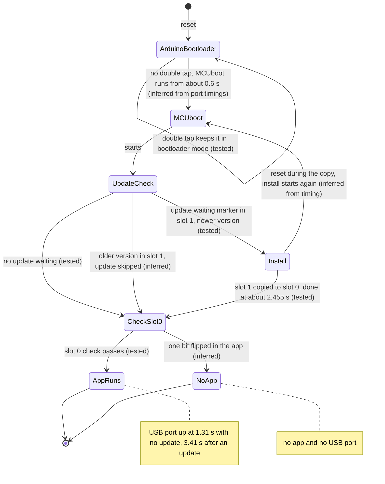

# Update flow of the overwrite-only build

This diagram shows what the board did in the overwrite-only build (Build B in the README): MCUboot at `0x10000`, slot 0 at `0x20000`, slot 1 at `0x40000`, slot-0 check on. Each arrow says whether I saw it on the hardware (tested) or worked it out from timings or from what the board printed (inferred). I never read the flash, and the board has no console during MCUboot.

## Where each arrow comes from

| Arrow | Evidence |
|---|---|
| Install, then CheckSlot0 | v1.0.1 in slot 1 and v1.0.0 in slot 0: the board printed v1.0.1 |
| Reset during the copy | 177 trials updated; cuts up to 2.44 s gave a port about 3.4 s later, the same as an uninterrupted update |
| Reset after the copy | cuts from 2.46 s gave a port about 1.2 s later, so the update had finished |
| Older version skipped | v0.9.0 in slot 1 and v1.0.1 in slot 0: the board kept printing v1.0.1 |
| NoApp | one bit flipped at `0x20400`: no app and no USB port, read as a refusal |
| Stays in bootloader | cuts at 0.4 s and 0.5 s: the board stayed in the Arduino bootloader |

## Not drawn, because it was not tested

- Swap-based updates with rollback. Build A was swap-using-offset, but its update never ran.
- A wrong-key image on the overwrite-only build.
- Which step of MCUboot each reset hit.
- A real power cut or brownout. The test used a reset.
